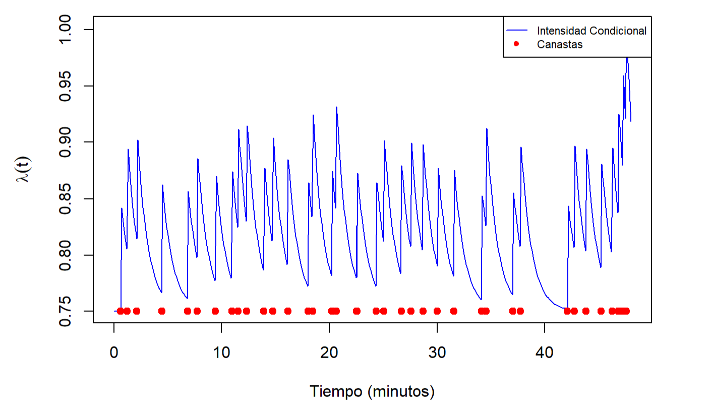

# Chicago Bulls scoring patterns

Statistical analysis of Chicago Bulls scoring sequences in R, based on my
2024–2025 Mathematics bachelor's thesis, *Modelos estadísticos de tipo self-exciting*.

**Author:** Marc Valero Ferrer.

The study asks whether made field goals exhibit temporal clustering consistent
with scoring runs. It considers two- and three-point baskets, excluding free
throws, for the team and selected players.



*Original illustration with fixed parameters mu = 0.75, theta = 0.1 and phi = 1.
This curve illustrates the model; it is not an estimated result.*

## Model and scope

The conditional intensity is

$$\lambda(t\mid\mathcal H_t)=\mu+\sum_{t_i<t}\theta e^{-\phi(t-t_i)}.$$

Mu is the background rate, theta is the jump following a basket, and phi is the
decay rate. Parameters are estimated by minimizing a numerical negative
log-likelihood. The history restarts for each game in a joint fit.

The executable selection covers team games 7 and 70, DeMar DeRozan game 35,
Zach LaVine game 53, and the joint team fit across all 84 supplied games.
The single-game examples also include fits from `stelfi`.

The original conventions are retained: a one-minute midpoint sum for individual
comparisons, and the appendix's trapezoid on `[0.5, T - 0.5]` for the joint fit.
DEoptim uses 1,000 iterations and bounds `(0, 0, 0)` to `(2, 2, 100)`.
The explicit seeds belong to this reproducible workflow; the original random
states were not recorded.

## Object-oriented design

The code uses R's native S3 system, with four classes:

| Class | Responsibility | Main methods |
|---|---|---|
| `scoring_data` | Load and prepare the supplied shots | `series()`, `as.data.frame()`, `print()` |
| `scoring_series` | Hold event histories and observation windows | `nobs()`, `print()` |
| `scoring_model` | Define the intensity, integration and fitting settings | `intensity()`, `objective()`, `fit()` |
| `scoring_fit` | Store coefficients, diagnostics and the analysed series | `coef()`, `predict()`, `plot()`, `as.data.frame()` |

For example, from the repository root:

```r
source("R/load.R")
data <- scoring_data()
events <- series(data, subject = "Zach LaVine", games = 53, label = "lavine_53")
model <- scoring_model("midpoint")
result <- fit(model, events, seed = 20261004L)
coef(result)
predict(result)
plot(result)
```

`predict()` evaluates the fitted conditional intensity within an observed game;
it is not an out-of-sample forecasting model. `plot()` uses stored coefficients
and does not fit the model again. Joint fits require an explicit `match_id` when
predicting or plotting. Saved RDS objects can be loaded in a fresh session after
sourcing `R/load.R`.

The `games` argument selects the thesis's `match_id` values, rather than the
upstream `game_id` column in the raw data.

## Files

```text
R/                     S3 classes, numerical functions and output helpers
scripts/               Preparation, fitting, comparison and checks
reports/analysis.Rmd   Report source; reads saved results
data/raw/              Unchanged supplied input
data/processed/        Regenerated CSV files, ignored by Git
results/reference/     Thesis/HTML reference values and original illustration
results/reproduced/    Fitted objects, tables, plots and session records
docs/                  Thesis, provenance, statistical notes and verification
```

## Data

`data/raw/shots_CHI.RData` contains 9,109 shot records and 84 game identifiers,
dated 19 October 2022 to 14 April 2023. Filtering yields 3,566 made field goals:
2,697 two-pointers and 869 three-pointers. Original game IDs and time conversion
are retained.

The data were supplied with the thesis workspace, and the author has confirmed
permission to include them. The upstream provider, acquisition procedure and
separate third-party terms were not recorded. No upstream open-data licence is
assumed. See [data documentation](data/README.md).

## Installation and execution

R is required. Data preparation and core checks use base R. Fitting requires
`DEoptim`; the comparison requires `stelfi`; HTML rendering requires
`rmarkdown`, `knitr` and Pandoc, which is included with RStudio.

To install packages locally, run this once in an R console opened in this folder:

```r
dir.create(".R-library", showWarnings = FALSE)
.libPaths(c(normalizePath(".R-library"), .libPaths()))
install.packages(c("DEoptim", "stelfi", "rmarkdown", "knitr"),
                 lib = ".R-library", repos = "https://cloud.r-project.org")
```

From a terminal in the repository root:

```sh
Rscript --vanilla scripts/01_prepare_data.R
Rscript --vanilla scripts/check_core.R
Rscript --vanilla scripts/02_fit_deoptim.R
Rscript --vanilla scripts/03_compare_stelfi.R
Rscript --vanilla scripts/check_results.R
Rscript --vanilla scripts/04_render_report.R
```

In RStudio, start a fresh session in this folder and use `source()` on the same
scripts in order. If Rscript is not on PATH, use the full path to your R
installation. If a terminal cannot find Pandoc, render from RStudio or set
`RSTUDIO_PANDOC` to the directory containing its executable. If CRAN does not
provide binaries for your R release, a newer R installation or build tools may
be needed.

The joint fit takes longer than the individual examples. Results include CSV
tables, RDS fit objects, PNG plots and session records. The report renders to
HTML without running optimizers. Verified versions and execution details are
in [the verification record](docs/verification.md).

## Results and statistical limitations

The thesis identifies clustering in selected games and contrasts DeRozan's
more regular scoring with LaVine's more intermittent scoring. The team-season
estimate has theta approximately zero. The reproduced team-season objective
agrees with the displayed thesis value, while some individual estimates differ.
Reference and computed results are kept separately.

These are exploratory temporal patterns, not a causal demonstration of the
hot-hand effect. Player court time, shot opportunities and contextual covariates
are not modelled. Player observation windows may be truncated, and phi becomes
poorly identified as theta approaches zero.

The two estimation procedures also have different parameter spaces:
`stelfi` 1.0.1's default model imposes theta < phi, whereas the original DEoptim
fit uses only box bounds. For example, the DeRozan-35 DEoptim result has
theta > phi. The comparison is therefore not a controlled comparison of
optimizers. Its common numerical score is distinct from stelfi's internal
objective. A covariance warning for team game 70 is retained with the results.

## Relationship to the thesis

The [original thesis](docs/TFG_memoria.pdf) supplies the academic context:
Chapter 5 contains the application, Chapter 6 the conclusions and Appendix 7.1
the likelihood code. This repository contains a selected executable subset.

Preparation consolidated repeated code into S3 classes, replaced local paths,
separated data and outputs, corrected game labels and the overwritten team
duration variable, and recorded seeds and optimizer diagnostics. Numerical
rules and known statistical limitations are documented rather than changed.
Plots use a common vertical scale from zero for each method comparison.

The final highlighted-game joint selections and confidence-interval scenarios
are omitted because their provenance is incomplete. Home/away effects,
court-time covariates, marked models and Bayesian inference remain future work.

See [source provenance](docs/provenance.md), [changes](docs/changes.md),
[statistical review](docs/statistical-review.md) and [verification](docs/verification.md).
